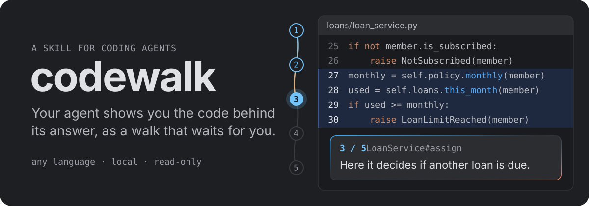
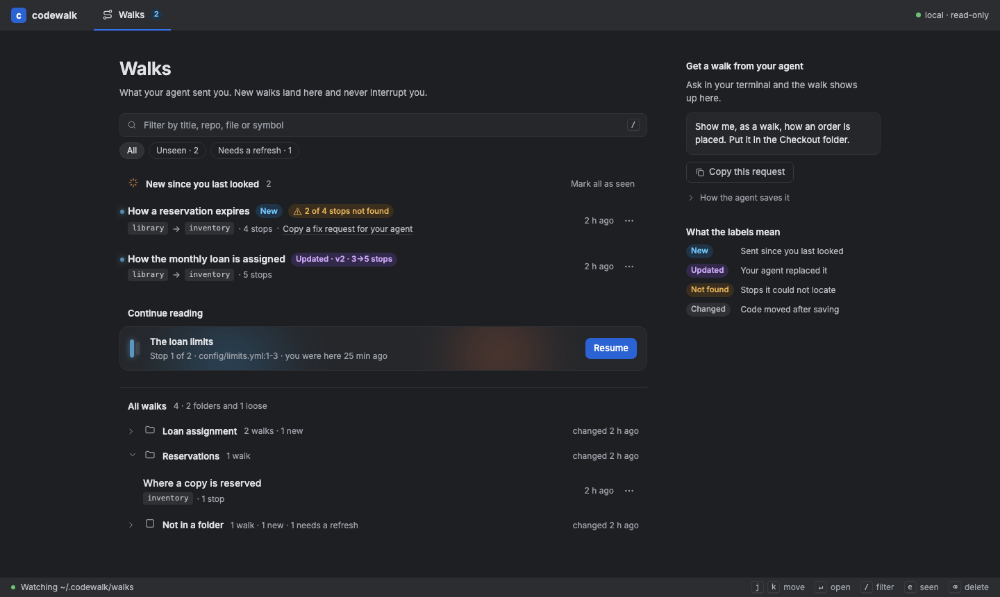
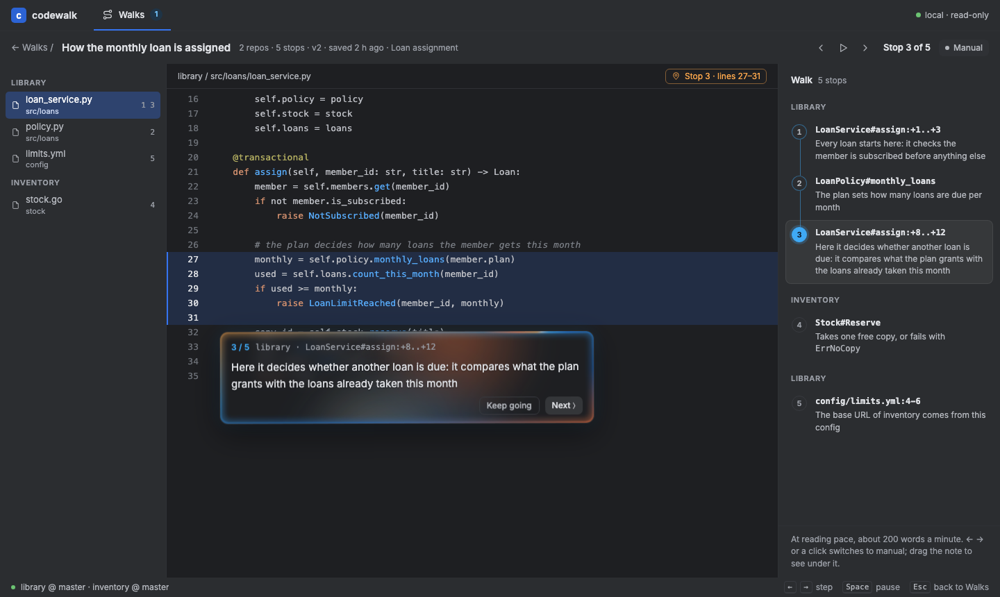
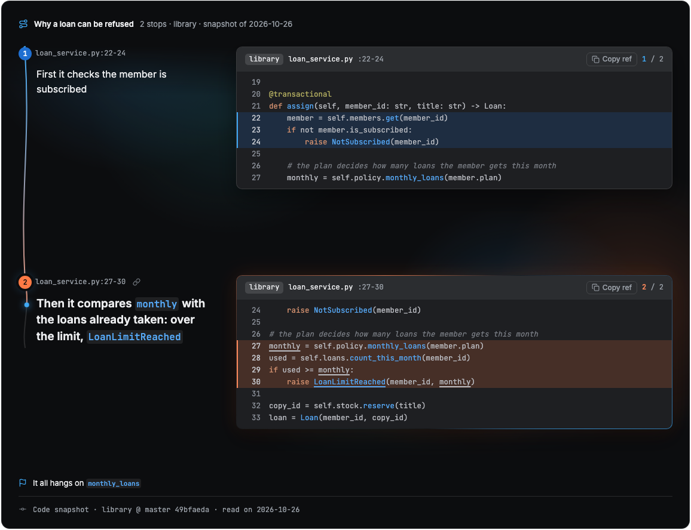

<p align="center"></p>

[English](README.md) · **Español**

Preguntale a tu agente "¿dónde está X?" o "haceme el recorrido de Y" y te responde con un **walk**: unas pocas paradas por el
código real, cada una con una frase sobre qué mirar. El walk llega a una página local, Walks, y te espera ahí hasta que lo
abrís.

## Qué ves

**La página Walks** es una bandeja. Primero los walks nuevos y actualizados, después el que estabas leyendo, después los que
tienen código que cambió desde que se guardaron, y al final todos por carpeta. Nada se abre solo: un walk nuevo muestra un
aviso.

<p align="center"></p>

**Un walk** avanza a ritmo de lectura, o parada por parada con ← →. El código de cada parada aparece resaltado y la frase del
agente queda justo abajo. Si el agente reemplaza el walk que estás leyendo, la versión nueva entra en el lugar y seguís en la
misma parada.

<p align="center"></p>

## Cómo funciona

1. Preguntás. El agente escribe las paradas, una por línea: `<repo> <destino> <frase>`.
2. Las resuelve con `codewalk.py walk -n` y corrige las que no pudo ubicar, antes de que veas nada.
3. Guarda el walk como un JSON en `~/.codewalk/walks/`, en una carpeta si corresponde.
4. La pestaña de Walks abierta lo levanta. Si no hay pestaña, el agente te pasa el link.

Un destino puede ser una ruta con líneas o un símbolo, en cualquier lenguaje: el CLI encuentra la definición con `git grep`
y lee dónde termina con [Pygments](https://pygments.org/).

| Destino | Ejemplo |
|---|---|
| Tipo, método o función | `OrderService#place`, `User#valid?`, `Stock#Reserve` |
| Una parte de uno | `OrderService#place:+4..+12` |
| Función de un módulo o paquete | `slugs#slugify`, `parser#Parse` |
| Ruta con líneas | `config/limits.yml:3-8` |

## Para quien no tiene los repos

Cuando la respuesta va en un artifact, `block` arma el mismo walk como un bloque HTML autocontenido: código resaltado,
siempre oscuro, con una parada pico y una frase de cierre.

<p align="center"></p>

## Instalación

Necesita [`uv`](https://docs.astral.sh/uv/) y `git`. Poné la carpeta donde tu agente busca skills, por ejemplo:

```bash
git clone https://github.com/azamma/skills.git
ln -s "$PWD/skills/codewalk" ~/.claude/skills/codewalk
```

La skill se activa sola. A mano, desde su carpeta:

```bash
uv run scripts/codewalk.py open        # la página Walks
uv run scripts/codewalk.py list        # los walks guardados y sus ids
uv run scripts/codewalk.py walk --title "Cómo se arma un pedido" --folder "Checkout" < stops.txt
uv run scripts/codewalk.py block -o block.html < stops.txt
uv run scripts/codewalk.py selftest
```

## Para tener en cuenta

- **Local y de solo lectura.** El server escucha en `127.0.0.1`, rechaza otros hosts y pedidos cross-site, y solo sirve
  archivos que un walk nombra y que git sigue en ese repo. Nunca escribe en un repo.
- **Encontrar símbolos es una heurística.** Reconoce definiciones por palabra clave (`def`, `fn`, `func`, `class`, `struct`,
  `impl`…), por declaraciones estilo C y por métodos de JS/TS; dónde termina una sale de las llaves o de la sangría. Una
  parada que no logra ubicar vuelve `unresolved`, o `ambiguous` con candidatos, y el agente la reenvía como ruta.
- **Los walks quedan hasta que los borrás.** Qué viste y dónde dejaste de leer se guarda en tu navegador, no con los walks.
- Los archivos de más de 1 MB y los binarios no se muestran.
