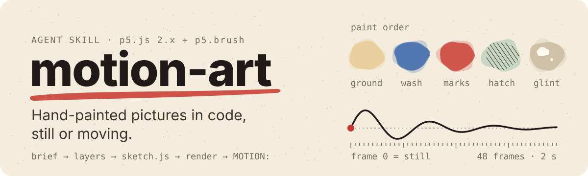
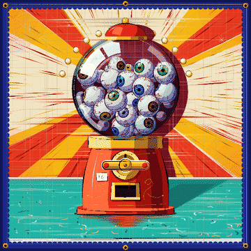
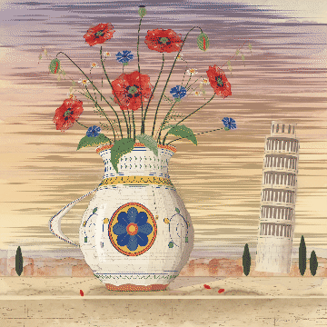
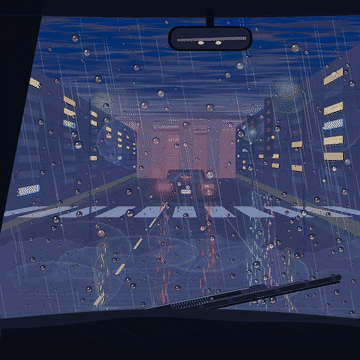
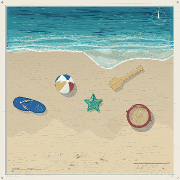

<p align="center"></p>

<p></p>

# motion-art

[English](README.md) · **Español**

Pinturas hechas con código que parecen pintadas a mano, quietas o en movimiento. Un objeto cotidiano dibujado hiperreal dentro de una tradición artística con nombre (cartel de feria, mayólica, shin-hanga, carta náutica), pintado con p5.js 2.x + [p5.brush](https://github.com/acamposuribe/p5.brush) en un canvas de 1200x1200.

## Qué hace

Sale del estudio de una galería de 534 pinturas y 26 animaciones generadas con código. Le da al agente el método completo:

- escribir un brief (objeto, tradición, técnicas, puntos hiperreales, paleta, luz) y elegir un colour hint;
- planear las capas de fondo a brillos y escribir el `sketch.js` partiendo de una plantilla;
- renderizar en Chrome headless, comparar contra referencias y corregir con una lista de autocrítica;
- animar a partir de una línea `MOTION:`: un clip de 2 s donde cada verbo es una capa y la escena reacciona (luz, sombras, reflejos, fondo), verificado comparando cuadros.

## Cómo usarla

Se activa sola cuando pedís una pintura con brief y colour hint, una pintura con p5.brush o una animación con una línea `MOTION:`. A mano:

```bash
scripts/render.sh sketch.js out.png                  # PNG + out.html para abrir en el navegador
QUERY="frame=12" scripts/render.sh sketch.js f12.png  # un cuadro de la animación
FRAMES=48 scripts/render.sh sketch.js frames/         # los 48 cuadros del clip
uv run --with pillow python scripts/gif.py frames/ clip.gif   # GIF en loop para un README
```

Necesita Google Chrome o Chromium (o `CHROME=/ruta/al/binario`) y Node 22+. Para armar el MP4 sin ffmpeg instalado: `uv run --with imageio --with imageio-ffmpeg`.

## Lo que hay que saber

- **Renderizar tarda.** Una pieza completa lleva 2 a 3 minutos con SwiftShader. Renderizá de a una.
- **Las imágenes de referencia no vienen en el repo.** Son de una galería de terceros sin licencia declarada; ver `assets/refs/README.md`. Sin ellas la skill funciona con las reglas escritas de `references/visual-signature.md`.
- **p5.brush 2.2.3 tiene trampas** (cuándo vuelca al canvas, el orden fill/wash, washes que se pierden). Están documentadas en la sección *Paint order* de `SKILL.md`.
- Incluye p5.js 2.3.1 (LGPL-2.1) y p5.brush 2.2.3 (MIT) en `assets/vendor/` para renderizar sin internet.
