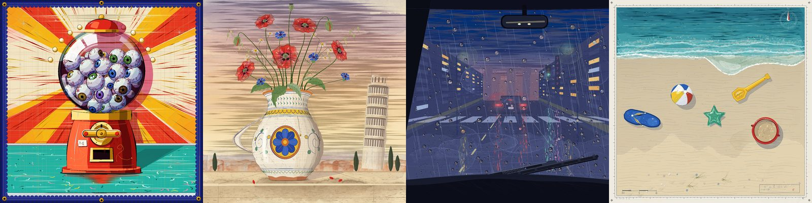

# motion-art

Code-made paintings that look hand-painted, still or moving. One everyday object rendered hyperreal inside a named art tradition (carnival banner, maiolica, shin-hanga, nautical chart), painted with p5.js 2.x + [p5.brush](https://github.com/acamposuribe/p5.brush) on a 1200x1200 canvas.

## What it does

It comes from studying a gallery of 534 code-generated paintings and 26 animations, and gives the agent the whole method:

- write a brief (object, tradition, media, hyperreal hotspots, palette, light) and pick a colour hint;
- plan the layers from ground to highlights and write `sketch.js` from a template;
- render in headless Chrome, compare against references and fix with a self-critique checklist;
- animate from a `MOTION:` line: a 2 s clip where every verb becomes a layer and the scene reacts (light, shadows, reflections, background), verified by diffing frames.

## How to use it

It triggers on its own when you ask for a painting with a brief and colour hint, a p5.brush painting, or an animation with a `MOTION:` line. By hand:

```bash
scripts/render.sh sketch.js out.png                  # PNG + out.html to open in a browser
QUERY="frame=12" scripts/render.sh sketch.js f12.png  # one frame of the animation
FRAMES=48 scripts/render.sh sketch.js frames/         # all 48 frames of the clip
```

Needs Google Chrome and Node 22+. To build the MP4 without a system ffmpeg: `uv run --with imageio --with imageio-ffmpeg`.

## Good to know

- **Rendering is slow.** A full piece takes 2–3 minutes under SwiftShader. Render one at a time.
- **The reference images are not in the repo.** They come from a third-party gallery with no declared licence; see `assets/refs/README.md`. Without them the skill works from the written rules in `references/visual-signature.md`.
- **p5.brush 2.2.3 has traps** (when it flushes to the canvas, fill/wash order, washes that get dropped). They are documented under *Paint order* in `SKILL.md`.
- Ships p5.js 2.3.1 (LGPL-2.1) and p5.brush 2.2.3 (MIT) in `assets/vendor/` so renders work offline.
